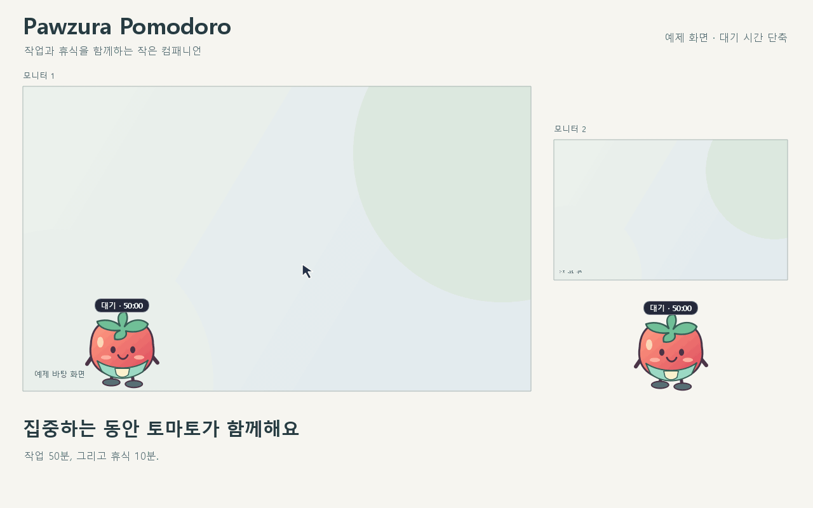

[English](README.md) · [한국어](README.ko.md)

# Pawzura 포모도로

화면을 걸어 다니는 컴패니언이 있는 무음 Windows 타이머예요. 기본값은 작업 50분, 휴식 10분이에요.

## 만든 이유

작업에 몰두하다 보면 중간에 쉴 생각을 못 할 때가 있어요. 스마트폰에 포모도로 앱을 켜 놓아도 작업 중에는 폰이 눈에 잘 들어오지 않아요. 시간을 확인하려고 폰을 들었다가 오히려 폰으로 시간을 낭비하게 되기도 하고요.

그래서 지금 보고 있는 컴퓨터 화면에 휴식할 시간이라는 표시가 크고 분명하게 나타나면 좋겠다고 생각했어요. 쉬어야 할 때를 놓치지 않도록 눈에 띄는 시각적 알림을 만들고 싶어서 Pawzura 포모도로를 만들었어요.

[Releases](https://github.com/hobby-programmer-5000/pawzura-pomodoro/releases)에서 **포터블 ZIP** 또는 **단일 EXE**를 선택하세요. ZIP은 전체를 풀고 **PawzuraPomodoro.exe**를 실행하며, 버전 이름이 붙은 단일 EXE는 그 파일만 실행하면 돼요. 둘 다 Python 설치는 필요 없어요. 이번 알파는 미서명이라 SmartScreen 경고가 나타날 수 있어요. [빌드·검증·삭제 안내](BUILD.ko.md).

[Windows 11 수동 테스트 시나리오](TESTING.ko.md).

[MP4 데모 보기](media/pomodoro-demo-0.1.0a3-ko.mp4). 새 36초 알파 3 데모는 캐릭터 선택·앉기·휴식 중 눈 감기·앉아서 대기·일어난 뒤 걷기와 50/10 기본값, Windows 자동 시작 옵션, 알림 설정을 실제 앱 화면으로 보여줘요. 두 예제 바탕 화면과 가속 시계를 사용해요. [데모 설명과 다시 만들기](media/README.ko.md).

1. 표준 CPython 3.12 이상을 사용해요. Python 3.14가 있다면 `py -3.14 -m venv .venv-standard`로 환경을 만들고 `.\.venv-standard\Scripts\python.exe -m pip install -r requirements.txt`를 실행한 뒤 [run.bat](run.bat)을 열어요. 같은 환경에서 `python -m pomodoro`로도 실행할 수 있어요.
2. 타이머 표시를 클릭해서 시작, 일시정지, 재개해요. 작업이 끝나면 휴식이 자동으로 시작돼요. 휴식이 끝난 뒤 타이머 표시를 다시 클릭하면 다음 작업이 시작돼요.
3. 컴패니언이나 트레이 아이콘을 우클릭하면 **옵션**, **언어**, **시각 효과 설정**을 사용할 수 있어요. 설정은 즉시 저장돼요. 작업과 휴식은 각각 1~180분으로 설정할 수 있고, 시간 변경은 다음 구간부터 적용돼요.

**옵션 > 시각 효과**에서 **표시할 때**를 선택한 뒤 모양과 유지 방식을 정해요. 작업 시작, 휴식 시작, 휴식 종료를 각각 설정할 수 있어요.

- **테두리 빛**, **컴패니언 말풍선**, **상단 배너**, **반투명 덮개**, **화면 전체 가림** 중에서 선택해요. 연결된 모든 모니터에 표시돼요.
- 1~60초 동안 표시하거나, 클릭해서 닫을 때까지 또는 작업·휴식 구간 내내 유지할 수 있어요.
- 클릭 가능한 효과에서 **화면 아무 곳이나 클릭해서 닫기**를 켤 수 있어요. 닫아도 타이머 상태는 유지돼요. 다음 작업을 시작하려면 **작업 시작** 버튼을 눌러요.
- **모든 모니터에서 미리보기**로 설정을 시험해볼 수 있어요. 미리보기의 닫기 버튼을 누르거나, 설정한 시간이 지나면 사라져요.

기본값은 작업 시작 시 테두리 빛 1초, 휴식 시작 시 반투명 덮개 3초예요. 휴식이 끝나면 응답할 때까지 반투명 덮개가 유지돼요. **작업 시작**을 누르면 모든 화면에서 닫히고 작업 시간이 처음부터 시작돼요. **2분 뒤 다시 알림**은 효과를 잠시 닫고 다시 알려줘요. 간격은 1~30분으로 바꿀 수 있어요.

**이번 효과 닫기**를 누르면 현재 효과와 예약된 다시 알림이 취소돼요. 클릭 가능한 효과와 두 메뉴의 **시각 효과 끄기**는 이후 효과도 꺼요. 타이머는 계속 작동해요. 몇 초 동안 표시하는 효과는 마우스 클릭이 통과하며, 화면 전체 가림에는 직접 닫을 수 있는 버튼이 표시돼요.

**옵션 > 일반 > 캐릭터**에서 그림을 보고 **기존 토마토** 또는 **민트색 앞치마 토마토**를 고를 수 있어요. 컴패니언·트레이 아이콘·알림에 바로 반영되고 다음 실행에도 유지돼요. 타이머와 현재 자세는 그대로예요. 기존 그림은 MIT를 유지하고 앞치마 그림은 아래의 별도 조건을 따라요.

어느 캐릭터든 휴식이 시작되면 그 자리에서 멈춰 앉고 눈을 감아요. 휴식이 끝나도 눈을 뜬 채 앉아서 기다려요. 작업을 시작하면 먼저 일어난 뒤 걸어요. 휴식을 일시정지해도 쉬는 자세를 유지하고 걷기·고정 설정은 보존해요.

컴패니언을 드래그하면 그 자리에 고정돼요. **컴패니언 걷기**를 다시 켜면 걷기 시작해요. 옵션에서 걷는 방향을 바꾸거나 **컴패니언 제자리로**를 선택해 주 모니터로 옮길 수 있어요.

코드는 [MIT](LICENSE)를 유지해요. 새 민트색 앞치마 캐릭터는 **CC BY-NC-SA 4.0**이며 일반적인 유료 업무 중 앱 사용은 별도 허용해요. 캐릭터 상품·브랜딩·캐릭터 자체의 상업적 이용은 별도 허락이 필요해요. 이전 MIT 토마토의 기존 허락은 유지돼요. [캐릭터 정책](CHARACTER-POLICY.ko.md)과 [정확한 자산 등록부](ASSET-LICENSING.ko.md)를 확인하세요. 이동과 드래그는 Pawzura의 컴패니언 조작 코드를 재사용해요. 런타임은 기존 PySide6 Essentials 및 Shiboken 6.12.0을 사용해요. LGPL 조건과 배포 의무는 [외부 구성요소 고지](THIRD-PARTY-NOTICES.ko.md)를, 화면 제어 아이디어는 [참고 및 영감](INSPIRATION.ko.md)을 참고하세요.

Pawzura 이동 코드는 [커밋 23bd3b9](https://github.com/hobby-programmer-5000/pawzura/blob/23bd3b90435d6e5ab6c0dd510d8dc5b8897489a6/pawzura/pet.py)과 requirements.txt의 압축 파일 SHA256에 고정돼 있어요. 공개 소스 압축 파일에서 패키지를 설치해요.

개발 검사는 `python -m unittest discover -s tests -v`로 실행해요. Windows 11 검사 결과와 방법, 남은 범위는 [테스트 결과](RESULTS.ko.md)에 기록했어요. 제품 소유와 AI 구현 역할은 [기여자](CONTRIBUTORS.ko.md)에 기록했어요.

**옵션 > 일반 > Windows 로그인 시 자동 시작**은 선택한 EXE를 로그인 때 실행해요. 기본은 꺼짐이며, 켜기 전에 EXE를 계속 사용할 폴더에 두세요. 일반 배포 실행에서 사용할 수 있고 소스/격리 시험 프로필에서는 비활성화돼요. 휴식 시간 옆 **50 / 10**은 다음 구간부터 기본 시간을 복원해요.

알파 2는 배포 앱의 설정을 이전 수동 시험·소스 설정과 분리해요. 이전 프로필에 1분이 저장됐어도 새 배포 프로필의 첫 실행은 50/10으로 시작해요. 새 프로필에서 바꾼 값은 이후에도 유지되고 두 EXE 형식이 공유해요. [설정 위치·이전 프로필 처리](BUILD.ko.md)를 참고하세요. **옵션 > 라이선스**에서는 구성요소 고지와 정확한 빌드 소스를 열 수 있어요.
