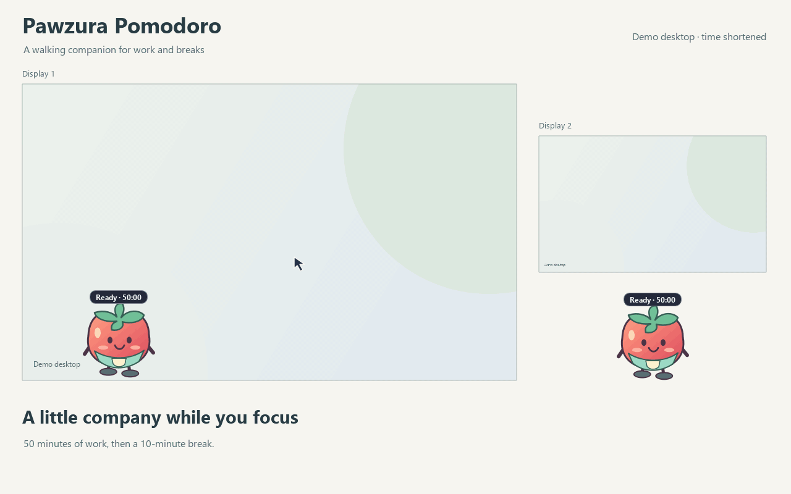

[English](README.md) · [한국어](README.ko.md)

# Pawzura Pomodoro

A silent Windows desktop timer with a walking companion. It starts with 50 minutes of work and a 10-minute break.

## Why I made this

When I get absorbed in work, I sometimes forget to take a break. Even with a Pomodoro timer running on my phone, I may not notice it because the phone is out of sight. And when I do pick it up to check the timer, I can end up wasting time on the phone.

I made Pawzura Pomodoro because I wanted a large, clear visual reminder on the screen I am already using, so I can notice when it is time to rest.

Download either the **portable ZIP** or the **standalone EXE** from [Releases](https://github.com/hobby-programmer-5000/pawzura-pomodoro/releases). For the ZIP, extract everything and open **PawzuraPomodoro.exe**. The versioned standalone EXE runs by itself. Neither needs Python installed. Version 0.2.0 is unsigned; SmartScreen can still warn. [Build, verification and removal](BUILD.md).

[Windows 11 manual test scenarios](TESTING.md).

[Watch the MP4 demo](media/pomodoro-demo-0.1.0a3-en.mp4). The 36-second feature demo shows choosing Classic or Mint apron tomato, sitting down, sleeping through a break, seated waiting and standing before walking, alongside 50/10 defaults, optional Windows startup and reminder controls using actual app widgets on two example desktops with an accelerated clock. [Demo details and regeneration](media/README.md).

1. Use standard CPython 3.12+. With Python 3.14 installed, create the environment using `py -3.14 -m venv .venv-standard`. Run `.\.venv-standard\Scripts\python.exe -m pip install -r requirements.txt`, then open [run.bat](run.bat). You can also run `python -m pomodoro` in that environment.
2. Click the timer badge to start, pause or resume. A break starts automatically when work ends. Click the badge again after the break to start the next work interval.
3. Right-click the companion or the tray icon for **Options**, **Language**, or **Visual effect settings**. Options save immediately. Work and break times are each 1 to 180 minutes. A duration change applies when the next interval starts.

Under **Options > Visual effects**, select **When to show**, then choose the appearance and how long it stays. Work start, break start and break end each have their own settings.

- Choose **Edge glow**, **Companion bubble**, **Top banner**, **Dim screen** or **Cover screen**. Every connected monitor shows the effect.
- Keep the effect visible for 1 to 60 seconds, until dismissed, or for the whole work/break interval.
- Enable **Click anywhere to dismiss** for an interactive effect. Dismissing leaves the timer in its current state. Click **Start work** to begin the next work interval.
- Use **Preview on all monitors** to try the selected effect. Close the preview with its button. A timed preview ends automatically.

By default, work starts with a 1-second edge glow and breaks with a 3-second dim. When a break ends, a dim screen stays visible until you respond. **Start work** closes it on every monitor and starts a full work interval. **Remind in 2 min** temporarily closes it and reminds you again; the interval is configurable from 1 to 30 minutes.

**Dismiss this effect** closes the current effect and cancels a pending reminder. **Turn effects off**, available on interactive effects and in both menus, also disables future effects. The timer continues. Timed effects allow clicks through, except the opaque cover, which has visible dismissal controls.

**Options > General > Character** lets you choose **Classic tomato** or **Mint apron tomato** with a picture of each. The change applies immediately to the companion, tray icon and reminders, and is saved for the next launch. It keeps the timer and current posture. Both drawings use MIT.

During a break, either companion stops in place, sits down and closes its eyes. It stays seated with eyes open while waiting for the next work interval. Starting work makes it stand up before it walks again. Pausing a break keeps it asleep; your walking/pinned preference is preserved.

Drag the companion to pin it. Turn **Let companion walk** back on to resume walking. Set the walking direction in Options, or choose **Bring companion back** to return it to the primary display.

Use **Hide companion** in the companion/tray menu, or clear **Options > General > Show desktop companion**, when the avatar is distracting. The avatar and badge disappear; the timer, tray controls and visual reminders keep running. Right-click the notification-area icon (possibly under **^**) > **Show companion** to restore it, or enable the checkbox. **Bring companion back** also shows it on the primary display. The choice survives restart without changing walking or pinned placement. If no system tray is available, Options opens; closing it restores the companion. Options tabs scroll on smaller displays.

The linked 0.1.0a3 recordings show the earlier feature set; they do not demonstrate hide/show and predate the new Options controls.

Original code, both companion drawings, icons and original demo material use [MIT](LICENSE). See the [artwork provenance](ASSET-LICENSING.md); third-party components retain their own terms. Movement and dragging reuse Pawzura's pet controls. The runtime uses the existing PySide6 Essentials and Shiboken 6.12.0. See the [dependency notices](THIRD-PARTY-NOTICES.md) for LGPL terms and distribution obligations, and [References and inspiration](INSPIRATION.md) for the ideas behind the display controls.

The Pawzura movement dependency is pinned to [commit 23bd3b9](https://github.com/hobby-programmer-5000/pawzura/blob/23bd3b90435d6e5ab6c0dd510d8dc5b8897489a6/pawzura/pet.py) and an archive SHA256 in requirements.txt. The package is installed from its public source archive.

Development checks use `python -m unittest discover -s tests -v`. Windows 11 testing results, methods and remaining coverage are recorded in [Test results](RESULTS.md). Product ownership and AI implementation roles are recorded in [Contributors](CONTRIBUTORS.md).

Under **Options > General**, **Start with Windows** starts the chosen EXE when you sign in. It is off by default; keep the EXE in a permanent folder before enabling it. This option is available in normal packaged runs and disabled in source/custom test profiles. **50 / 10** beside the break time restores the default durations for the next interval.

Alpha 2 separates the desktop profile from old manual-test/source settings. Its first normal run starts at 50/10 even if the old profile saved one minute. Later changes in the new desktop profile are preserved and shared by both EXE formats. See [profile locations and migration](BUILD.md). **Options > Licenses** opens component notices and the exact build source.
