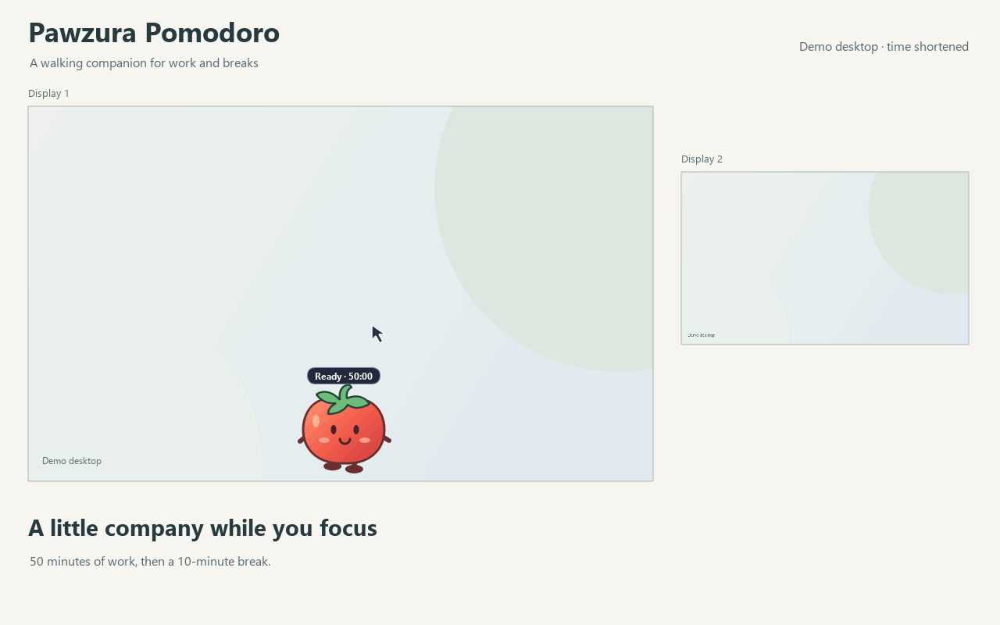

[English](README.md) · [한국어](README.ko.md)

# Pawzura Pomodoro

A silent Windows desktop timer with a walking companion. It starts with 50 minutes of work and a 10-minute break.

[Windows 11 manual test scenarios](TESTING.md).

[Watch the MP4 demo](media/pomodoro-demo-en.mp4). The 22-second demo uses actual app widgets on two example desktops with a shortened clock. [Demo details and regeneration](media/README.md).

1. Use standard CPython 3.12+. With Python 3.14 installed, create the environment using `py -3.14 -m venv .venv-standard`. Run `.\.venv-standard\Scripts\python.exe -m pip install -r requirements.txt`, then open [run.bat](run.bat). You can also run `python -m pomodoro` in that environment.
2. Click the timer badge to start, pause or resume. A break starts automatically when work ends. Click the badge again after the break to start the next work interval.
3. Right-click the companion or the tray icon for **Options**, **Language**, or **Visual effect settings**. Options save immediately. Work and break times are each 1 to 180 minutes. A duration change applies when the next interval starts.

Under **Options > Visual effects**, select **When to show**, then choose the appearance and how long it stays. Work start, break start and break end each have their own settings.

- Choose **Edge glow**, **Companion bubble**, **Top banner**, **Dim screen** or **Cover screen**. Every connected monitor shows the effect.
- Keep the effect visible for 1 to 60 seconds, until dismissed, or for the whole work/break interval.
- Enable **Click anywhere to dismiss** for an interactive effect. Dismissing leaves the timer in its current state. Click **Start work** to begin the next work interval.
- Use **Preview on all monitors** to try the selected effect. Close the preview with its button. A timed preview ends automatically.

By default, work starts with a 1-second edge glow and breaks with a 3-second dim. When a break ends, a dim screen stays visible until you respond. **Start work** closes it on every monitor and starts a full work interval. **Remind in 2 min** temporarily closes it and reminds you again; the interval is configurable from 1 to 30 minutes.

**Dismiss this effect** closes the current effect and cancels a pending reminder. **Turn effects off**, available on interactive effects and in both menus, also disables future effects. The timer continues. Timed effects allow clicks through, except the opaque cover, which has visible dismissal controls.

Drag the companion to pin it. Turn **Let companion walk** back on to resume walking. Set the walking direction in Options, or choose **Bring companion back** to return it to the primary display.

The original tomato drawing and timer code use the repository's [MIT license](LICENSE). Movement and dragging reuse Pawzura's pet controls. The runtime uses the existing PySide6 Essentials and Shiboken 6.12.0. See the [dependency notices](THIRD-PARTY-NOTICES.md) for LGPL terms and distribution obligations, and [References and inspiration](INSPIRATION.md) for the ideas behind the display controls.

The Pawzura movement dependency is pinned to [commit 23bd3b9](https://github.com/hobby-programmer-5000/pawzura/blob/23bd3b90435d6e5ab6c0dd510d8dc5b8897489a6/pawzura/pet.py) and an archive SHA256 in requirements.txt. The package is installed from its public source archive.

Development checks use `python -m unittest discover -s tests -v`. Windows 11 manual verification is pending. Product ownership and AI implementation roles are recorded in [Contributors](CONTRIBUTORS.md).
